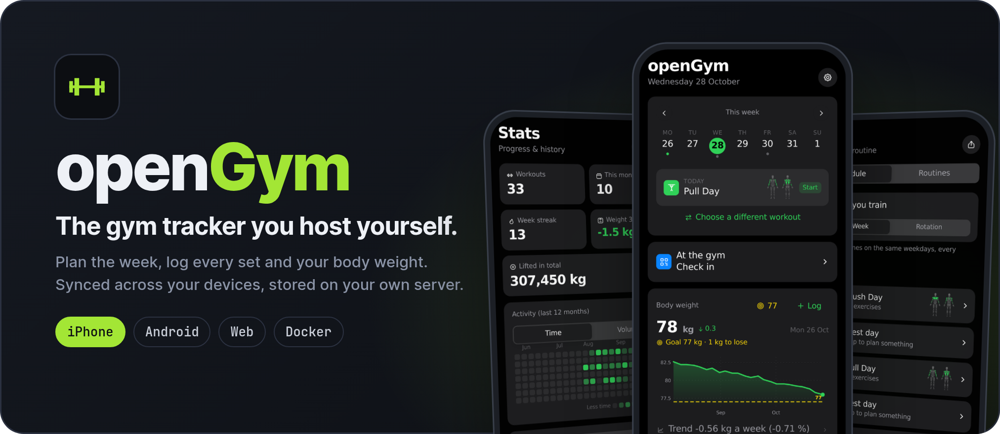

# GYM — личный дневник тренировок на iPhone

Локальная PWA на основе [openGym](https://github.com/DuarteSantos8/openGym).
Рабочий repository: [IF911/GYM](https://github.com/IF911/GYM), ветка `main`.
Текущая база openGym: **1.4.3**, `e6a95c28a6e3067bdd9b1188d5f37f448d528bd2`.
Исходная база локальной версии: `e348fc17c42c7e9a211c5972e573ad3698190ee2`.
Личная некоммерческая производная версия openGym. Локальные доработки сохранены при ручном обновлении 2026-10-27:
локальный режим без аккаунта и сети для данных, резервные копии, полная русская библиотека
упражнений, оценка расхода калорий, передача в Apple Health и публикация PWA в Pages.
В 1.4.3 добавлены реальные ступени веса тренажёров, быстрая замена упражнения на запасное,
CSV-экспорт, карта мышц программы и дополнительные настройки отдыха. Приняты ускорение
загрузки и исправления совместимости Safari; наши локальные ограничения и инструменты сохранены.
Исправление автоматической проверки обновления для разных дней недели также сохранено.

**Приложение:** [if911.github.io/GYM](https://if911.github.io/GYM/).

## Как устроено

GitHub Pages раздаёт только статические файлы приложения. Тренировки, программы,
вес и настройки сохраняются в хранилище браузера на устройстве. Сервер, аккаунт,
синхронизация, аналитика, AI и отправка тренировок отключены в `VITE_LOCAL=1`.
Материалы упражнений раздаются с того же сайта; сторонний CDN не нужен.

На iPhone открыть опубликованный сайт в Safari, выбрать **Поделиться → На экран
«Домой»**, затем запускать с появившейся иконки. Первый запуск выполнить с интернетом.

**Резервная копия:** Настройки → Данные и резервные копии → Экспорт (JSON).
Если используются собственные фото и видео, выбрать экспорт ZIP с медиа.
Для восстановления в этом же разделе выбрать импорт файла. Хранить копию в
**«На моём iPhone»** или на своём компьютере, если данные не должны попадать в iCloud.
Облачная папка в диалоге сохранения передаст выбранный backup её провайдеру.
Хранилище Safari может быть очищено; обновление кода его не очищает.
Если в импортируемой копии нет части текущих тренировок, GYM предлагает объединить записи
или явно заменить их. Объединение сохраняет также локальные настройки калорий и отметки
передачи в Health, даже если старая резервная копия ещё не содержала этих полей.

**Примерный расход и Apple Health:** после завершённой силовой тренировки оценка доступна в итоговом
экране и истории. Она считается на телефоне по длительности всей сессии, включая паузы, и выбранному
весу тела: `active = (MET - 1) × 3.5 × кг / 200 × минуты`. Уровни: `light = 3.0`, `moderate = 3.5`,
`vigorous = 6.0`; результат округляется до 10 ккал. Вес штанги, количество килограммов и повторов
не превращаются в отдельный множитель калорий, а выдуманный вес не подставляется. Чистые кардио-записи
пока не оцениваются. Настройки веса/интенсивности и локальная отметка передачи входят в JSON/ZIP backup.

Чтобы добавить запись в «Здоровье», на iPhone/iPad нажмите **«Добавить в Здоровье»**, затем
**«Установить команду GYM-Health»**. Это открывает [актуальный v2-файл
`GYM-Health.shortcut`](https://if911.github.io/GYM/shortcuts/v2/GYM-Health.shortcut).
Если Safari его скачал, откройте файл в «Файлах», добавьте команду с именем `GYM-Health`, затем
вернитесь в GYM с иконки на экране «Домой» и нажмите **«Я добавил команду»**. После этого кнопка
**«Добавить в Здоровье»** запускает передачу из итогового экрана или истории. Передача открывает Apple
Shortcuts с JSON только из версии, id, времени, длительности и active calories; HTTP, callback URL,
clipboard, список упражнений и заметки не используются. Сначала сохраняется локальная отметка `pending`;
открытие команды не доказывает запись в Health. Нажмите **«Тренировка есть в Здоровье»** после проверки.
Повторная передача доступна только через явное восстановление и предупреждает о возможном дубликате.
Использование Apple Health/iCloud зависит от выбора владельца устройства.

Это локальная оценка, а не измерение. Основа уровней MET — [Compendium: Conditioning Exercise](https://pacompendium.com/conditioning-exercise/)
и [Corrected METs](https://pacompendium.com/corrected-mets/). Файл shortcut собирается из детерминированного
источника, подписывается штатным macOS `shortcuts`, а source/signed SHA-256 проверяются тестом builder-а.
Для v2 используется путь `/shortcuts/v2/`; старый root URL обновляется алиасом, но Safari может держать
его в кэше. Если команда `GYM-Health` уже установлена, в приложении «Команды» удалите или замените
только старую команду и установите новую с тем же именем. Данные GYM и Safari для этого очищать не нужно.
v2 исправляет красные «Неизвестная переменная» в длительности/калориях и формат поля даты.
GYM предложит подтвердить установку обновлённой команды перед следующей передачей. Старая отметка
передачи сохраняется. Файл подписан, проверки структуры и ссылок на значения пройдены; фактическая
запись исправленной команды на iPhone ещё требует проверки. Данные не отправляются GYM-серверу или
в облако приложения; дальнейшее хранение в Apple Health/iCloud определяется настройками Apple.

## Русская библиотека и свои программы

Для всех 5632 упражнений переведены название, краткое описание и шаги техники.
Ещё 922 записи каталога — изображения того же упражнения с другой фигурой;
они используют текст основного упражнения. Язык: **Настройки → Единицы и язык → Язык → Русский**.
Русские тексты включены в установочный кэш, поэтому после первого успешного запуска
с интернетом доступны и офлайн. В GYM русский выбран по умолчанию. Старый английский
профиль один раз переключается на русский при получении этого обновления; история,
программы и вес сохраняются. Последующий выбор другого языка в настройках сохраняется.
В 92 исходных карточках есть противоречия или недостающие пояснения. В переводе они
отмечены конкретным примечанием: такой вариант нужно уточнить с тренером перед выполнением.
Результат отдельной проверки проблемных формулировок: [catalogue/ru-review.json](catalogue/ru-review.json).

При обновлении до openGym 1.4.3 все прежние русские названия, описания, шаги и примечания
сохранены без изменения. Новые строки интерфейса переведены; наши формулировки сохранены
поверх переводов автора. Проверка интерфейса охватывает 19 языков по 2576 ключей.

Проверка `ru-catalogue.test.js` требует русские тексты для каждого упражнения.
Если автор добавит новые упражнения без перевода, автоматическое обновление остановится
на проверке и сообщит об этом через обычную issue updater.

Готовую личную программу можно добавить через **План → значок «Поделиться» справа вверху →
Импортировать файл плана**. Это отдельный формат `opengym_plan`: он добавляет программы
и сохраняет историю. Если не нужно менять расписание недели, оставить соответствующий
переключатель выключенным. Импорт резервной копии в настройках данных предназначен
для восстановления дневника, а не для добавления программы.
Личные программы, заметки о здоровье и реальные дневники не публиковать в repository.

**Добавление без файла:** открыть **План** и нажать видимую кнопку
**«Добавить программу по ссылке»** над переключателем «Расписание / Программы».
Вставить защищённую ссылку и отдельный код, посмотреть состав и нажать «Добавить в мой план».
Программа находится в зашифрованной части адреса после `#`, которая не передаётся GitHub
в HTTP-запросе. Расшифровка и импорт выполняются на устройстве, публикации файла нет.
Код в ссылку не входит. Ссылка вместе с кодом даёт доступ к программе — хранить их приватно.
Ссылки не переносят историю тренировок и не заменяют резервную копию.

На iPhone надёжнее вставлять ссылку внутри GYM, открытого с иконки на главном экране:
внешний переход может открыть Safari с отдельным хранилищем. Прямой переход также поддержан:
зашифрованная часть убирается из текущего адреса сразу после открытия. Скопированная ссылка
может остаться в истории, чате или буфере обмена. Защищённые ссылки требуют современного
iOS/Safari с WebCrypto и Compression Streams; импорт файла доступен и без них.

В карточке упражнения дополнительные инструменты появляются по виду нагрузки: подбор блинов
для штанг и нагружаемого блинами оборудования, оценка максимума на один повтор — для подходящих
силовых упражнений. У прыжков, обычной работы с весом тела, удержаний, кардио и растяжки эти
блоки скрыты. Калькулятор не подставляет выдуманный рабочий вес при отсутствии истории.
Для тренажёра, который действительно нагружается блинами, в настройках упражнения есть
кнопка **«Этот тренажёр с блинами»**. Для блочного тренажёра достаточно записывать выбранный вес.
Подсказки с блинами используют **«Вес грифа»** или **«Вес без блинов»** и не меняют записи подходов.

## Обновления автора

Установленный GYM проверяет новую версию при открытии и возвращении в приложение с интернетом.
После загрузки файлов сверху появляется **«Новая версия готова» → «Обновить»**.
Нажать после завершения ввода: экран перезапустится, сохранённые программы, история и текущая
тренировка останутся на телефоне. Самостоятельной перезагрузки во время работы нет.
Проверить вручную: **Настройки → О приложении и обновления → Проверить обновление GYM**.
Офлайн приложение продолжает работать с уже установленной версией.
Сезонные темы и стили открываемых экранов не считаются обновлением: после установки
актуальной версии повторная проверка не должна снова показывать баннер.

Выпуски до этой кнопки не умеют менять уже открытый экран. Один раз открыть GYM с иконки
с интернетом, дать ему загрузить обновление, затем полностью закрыть его карточку в переключателе
приложений iPhone и снова открыть с иконки. Удалять приложение и очищать данные Safari не нужно:
очистка хранилища удалит локальный дневник. Внешняя ссылка в Safari может открыть отдельный профиль.

**GYM upstream sync** ежедневно около 05:17 по Москве проверяет `DuarteSantos8/openGym/main`.
Новые изменения сливаются с нашей веткой, проходят тесты и проверку сохранности дневника
при переходе со старой сборки на новую; после этого автоматически публикуются.
Если обновлений нет, повторной сборки и публикации нет. Тренировки телефона в этих проверках
не используются — проверяется искусственный дневник в отдельном браузере GitHub runner.
Проверка запускает выбранную тестовую программу как из плана на сегодня, так и из остальных
программ; понедельник больше не останавливает обновление ложной ошибкой запуска тренировки.

При конфликте, изменении защищённых файлов локального режима/хранения/backup/публикации,
провале тестов или ошибке запуска публикации процесс останавливается. Одна issue
**«GYM: автоматическое обновление остановлено»** создаётся в этом repository и назначается
владельцу. Повтор одного и того же препятствия не создаёт ежедневные уведомления.
Настройки уведомлений GitHub определяют, придёт ли письмо или push.
Результат самого развёртывания виден в Actions → **GYM local PWA**; ошибки этого workflow
также уведомляются средствами GitHub.

Для проверки вручную: Actions → **GYM upstream sync** → Run workflow на **main**.
Параметр `verify` запускает полную проверку совместимости даже без новых изменений,
но при отсутствии обновлений не меняет сайт. После 60 дней без активности GitHub может
отключить расписание публичного repository; в этом случае включите workflow снова в Actions.
Ограничения GitHub могут задерживать запуск относительно указанного времени.

Полная инструкция по установке, проверке и публикации: [docs/LOCAL_PWA.md](docs/LOCAL_PWA.md).
Результаты текущей реализации и оставшиеся этапы: [docs/LOCAL_PWA_HANDOFF.md](docs/LOCAL_PWA_HANDOFF.md).

## Сборка и проверка

Нужен Node 24 и npm. Из `frontend/`:

```sh
npm ci
npm run check:security
npm test
node --test ../scripts/upstream-sync.test.mjs
node scripts/check-locales.mjs
npm run build:local
python3 ../scripts/build-health-shortcut.test.py
```

Полный аудит зависимостей, включая инструменты сборки и тестирования, и реальные
проверки совместимости native tooling выполняются командой `check:security`.
Она обязательна и в публикации, и при upstream-обновлении. Исправления и причины
scoped overrides описаны в [docs/DEPENDENCY_SECURITY.md](docs/DEPENDENCY_SECURITY.md).

`frontend/dist/` — готовый статический сайт. Workflow **GYM local PWA** публикует
его в GitHub Pages после успешных проверок. При первом запуске в настройках
repository **Settings → Pages → Source** нужно выбрать **GitHub Actions**.
Бесплатный маршрут — публичный `IF911/GYM` и GitHub Pages. Публичны только код,
материалы упражнений и оболочка сайта; личные тренировки и backup-файлы в repository
и сборку не попадают.
Встроенный архив исходников содержит только код, необходимый по лицензии AGPL,
и не содержит тренировок. GitHub при загрузке сайта видит IP, но дневник ему не отправляется.

Не публиковать JSON/ZIP резервных копий, `.env`, ключи или любые реальные данные пользователя.
Для отката к предыдущему выпуску отменить конкретный commit в `main` и дождаться
повторной публикации. Перед откатом с изменением формата данных сохранить backup.

Лицензия и attribution openGym сохранены: [LICENSE](LICENSE), [NOTICE.md](NOTICE.md).
Ниже — исходное описание upstream для серверного и native-вариантов; они не являются
маршрутом публикации этой PWA.

---

<div align="center">

<p>
<picture>
  <source media="(prefers-color-scheme: dark)" srcset="assets/readme/hero-dark.png">
  <source media="(prefers-color-scheme: light)" srcset="assets/readme/hero-light.png">
  
</picture>
</p>

<a href="https://discord.gg/e62jY6fwVb"></a>
<a href="https://github.com/DuarteSantos8/openGym/stargazers"></a>
<a href="https://github.com/DuarteSantos8/openGym/releases"></a>
<a href="https://github.com/DuarteSantos8/openGym/releases"></a>
<a href="https://github.com/DuarteSantos8/openGym/actions/workflows/test.yml"></a>
<a href="LICENSE"></a>

<a href="https://apps.apple.com/app/id6822275400"></a>
<a href="https://github.com/DuarteSantos8/openGym/releases/latest"></a>
<a href="docs/SELF_HOSTING.md"></a>

<a href="https://trendshift.io/repositories/88268?utm_source=repository-badge&amp;utm_medium=badge&amp;utm_campaign=badge-repository-88268" target="_blank" rel="noopener noreferrer"></a>
<a href="https://trendshift.io/repositories/88268?utm_source=trendshift-badge&amp;utm_medium=badge&amp;utm_campaign=badge-trendshift-88268" target="_blank" rel="noopener noreferrer"></a>

[Website](https://opengym.ch) · [Live demo](https://opengym.ch/demo/) · [Roadmap](ROADMAP.md) · [Changelog](CHANGELOG.md)

<a href="https://buymeacoffee.com/duartesantos"></a>
<a href="https://ko-fi.com/opengym"></a>

</div>

## Why openGym

Most workout apps keep your data on their servers, push you towards a subscription, or vanish
when the company does. openGym runs on your own box, keeps your data in a folder you control, and
is yours to fork. It still behaves like a modern app: installable on the home screen, passkey
sign-in, works offline, syncs between your phone and your laptop.

No account on someone else's server, no subscription, no ads, no telemetry. One
`docker compose up` and it's running.

The [in-browser demo](https://opengym.ch/demo/) is the real app with example data,
if you want to try it before installing anything.

## Features

**Planning**

- A routine per weekday over a library of **over 5,600 exercises** with animated demos, searchable and
  browsable by muscle on a body map. Filter by the equipment you own.
- Four starter plans (Push/Pull/Legs, Upper/Lower, Full Body, 5×5) that load as ordinary,
  editable routines.
- Every session on the Plan page and today's on Home carries a tiny body map with the muscles it
  works lit up, so you know Leg Day is legs before you open it.
- Move a session to another day without touching the weekly plan. The week starts on Monday or
  Sunday, your choice.
- Or skip the weekdays altogether: a **rotation** (A, B, C, A, ...) where the next session is
  simply the next one you haven't done, however the week went.
- Supersets, warm-up sets, drop sets and rest-pause, timed exercises (planks, hangs, carries),
  cardio by time and speed, rest time per exercise, planned deloads.
- Your own exercises, with your own photo, GIF or short video. Location data is stripped on the
  device before upload.

**Training**

- Guided sessions: today's workout starts itself, weights are pre-filled from last time, a rest
  timer runs between sets, PRs are detected as you go. On a rest day it tells you when the next
  session is.
- A quiet workout screen: one menu per exercise, the set number as the set's own menu, card or
  list view. Switches in Settings bring the old button rows back if you liked them.
- Optional effort column as RIR or RPE, colour-coded, with a plain-language line per level.
- Plate math for barbell, EZ bar, trap bar and Smith machine, worked out from the plates you own.
- Bodyweight exercises know they carry no load: log reps, add a dip belt if you use one.
- Per-side reps for lunges and single-arm work, the screen stays awake while you train, and a
  rest-timer alert can flash the screen for loud gyms.
- Swipe a set left to delete it (with Undo) or right to copy it. Pyramid sets with their own reps
  and rest per set, and a scroll wheel for any rest time up to 15 minutes.

**Progress**

- Progression rules per routine or per exercise: linear, Greyskull LP, double progression through a
  visible rep range, triple progression (reps, then sets, then load), or adding time. Each target explains why it is that number; missed reps never
  add load, stalls trigger a deload.
- Estimated 1RM per exercise with its own curve, Structural Balance ratios (Poliquin, Thibaudeau,
  ATG), a year-long activity heatmap.
- A muscle map in three modes: where your volume went, what is still recovering, and what has gone
  untrained.
- Body-weight chart against a goal line, and progress photos on a timeline with a before/after
  slider.
- Edit any saved workout after the fact, log one you did on paper, or move it to the right date.
  Records are re-read from the corrected history.

**Accounts and data**

- Passkeys (Face ID, Touch ID, fingerprint) with per-profile data synced across devices. Password
  sign-in can be switched on per instance; new devices pair with a one-time code or QR.
- Two devices editing at once merge field by field instead of overwriting each other (see
  [sync](#how-sync-works)).
- Import from FitNotes, Strong, Hevy (CSV or API key) and Apple Health weight exports. Export
  everything as one JSON file whenever you like.
- Share a plan as a small file or print it as a PDF.
- Optional admin dashboard with invite-only signup and an activity log.
- 20 languages, including right-to-left Arabic and Traditional Chinese. Exercise names and
  instructions are translated for most of them.

**On the phone and the wrist**

- Apps for iPhone, iPad and Android that work on their own (no server, no account) or connected to
  yours. Rest timer in the notification shade, reminders, and Health Connect or Apple Health.
- A gym reminder, off by default: walk into one of your gyms and the phone nudges you to hit
  Start. Once a day at most, never after you trained, and your gyms stay on the phone.
- An Apple Watch app: tick off sets with the Digital Crown, a full-screen rest countdown, heart
  rate per set, and complications. Widgets and a Live Activity on the iPhone.

**Optional extras, off by default**

- An [AI coach](docs/AI_COACH.md) that drafts a week of routines and later suggests changes based on
  what you logged. You approve every change. It runs on your server with your own provider key
  (Anthropic, OpenAI, Gemini or any OpenAI-compatible endpoint, Ollama included).
- An [MCP server](mcp/README.md) so an assistant like Claude Desktop can answer questions about your
  training history, and log a workout you describe to it. Local; not part of the Docker build.

The full list of what changed release by release is in the [changelog](CHANGELOG.md).

## Quick start

You need [Docker](https://docs.docker.com/get-docker/) with Compose.

```bash
git clone https://github.com/DuarteSantos8/openGym
cd openGym
cp .env.example .env
docker compose pull      # prebuilt images, amd64 + arm64 (skip this to build from source)
docker compose up -d
```

Open <http://localhost:8080>, tap **Create profile**, and you're in. The exercise animations are
part of the image, so there's nothing else to download.

To reach it from your phone with passkeys you need HTTPS on a domain; that's a two-line change in
`.env`. The [self-hosting guide](docs/SELF_HOSTING.md) walks through Cloudflare Tunnel, Caddy,
Traefik and nginx, and there are separate guides for
[HTTPS on a LAN](docs/SELF_HOSTING_HTTPS.md), [a Mac with Tailscale](docs/SELF_HOSTING_MAC.md) and [Kubernetes](docs/SELF_HOSTING_KUBERNETES.md).

> [!NOTE]
> Images are published from the same tag to `ghcr.io/duartesantos8/opengym-{api,web}`
> (what `docker-compose.yml` pulls) and `registry.gitlab.com/duartesantos8/opengym/{api,web}`. Swap
> the `image:` lines if you prefer GitLab's registry, or run `docker compose up -d --build` to build
> locally. Either way you don't need Node on the host.

<details>
<summary><b>Configuration reference</b> (all through <code>.env</code>)</summary>

| Variable | What it does | Default |
|---|---|---|
| `RP_ID` | Hostname passkeys are bound to | `localhost` |
| `ORIGIN` | Full URL the app is served from | `http://localhost:8080` |
| `WEB_PORT` | Host port for the web UI | `8080` |
| `NGINX_PORT` | Port the web container listens on inside the container | `80` |
| `BACKEND` | Name of the API service that `/api` is proxied to | `api` |
| `PORT` | Port the API listens on; the web container proxies to the same value | `3000` |
| `RP_NAME` | Name shown in the passkey prompt | `openGym` |
| `SESSION_DAYS` | How long a sign-in lasts, in days | `90` |
| `ADMIN_UIDS` | User ids that get the admin dashboard, comma-separated | *(none)* |
| `FIRST_USER_ADMIN` | `1`: the first profile created on an empty instance becomes its admin | *(off)* |
| `INVITE_ONLY` | Require an invite code to create a profile | *(off)* |
| `ALLOW_GUEST` | Offer "Continue without account"; `0` requires a profile | *(on)* |
| `PASSWORD_LOGIN` | Offer name-and-password sign-in next to passkeys | *(off)* |
| `TRUST_PROXY` | Let the sign-in throttle read the client address from proxy headers | `1` in `docker-compose.yml` |
| `AUDIT_LOG` | Record sign-ins and admin actions; `0` records nothing | *(on)* |
| `AUDIT_MAX` | Events kept in the activity log; `0` for no limit | `5000` |
| `AUDIT_DAYS` | Days kept in the activity log; `0` keeps until `AUDIT_MAX` | `90` |
| `AUDIT_IP` | Record the caller's address: `off`, `net` (network only) or `full` | `off` |
| `ALLOWED_PRIVATE_IPS` | Private addresses push endpoints may resolve to (FakeDNS, split-horizon DNS): comma-separated IPs, `a-b` ranges or CIDR blocks | *(none)* |
| `VAPID_SUBJECT` | Contact URL sent with push notifications | your `ORIGIN` |
| `API_TARGET` | API image to build: `default`, or `coach` with the Claude Agent SDK and Codex CLI | `default` |
| `COACH_DISABLED` | `1` forces the AI coach off instance-wide | *(unset)* |

Push-notification keys are generated on first run into `./data/vapid.json`. `DATA_DIR` is pinned to
`/data` inside the container and mapped to `./data` on the host; change the volume, not the
variable. The [self-hosting guide](docs/SELF_HOSTING.md) covers every option in detail.

</details>

## Phone app

The same codebase builds the phone apps with Capacitor. Use them on their own (everything stays on
the phone, no account) or connect them to your server and sync.

| | Get it |
|---|---|
| **iPhone and iPad**, with the **Apple Watch** app | The [App Store](https://apps.apple.com/app/id6822275400), in every App Store country |
| **Android** | The signed APK from the [latest release](https://github.com/DuarteSantos8/openGym/releases/latest) or [opengym.ch](https://opengym.ch), in three sizes: **Standard** (`openGym-X.Y.Z.apk`, animations at 180 px, about 315 MB), **Plus** (`openGym-Plus-X.Y.Z.apk`, 240 px, about 424 MB) and **HD** (`openGym-HD-X.Y.Z.apk`, 360 px, about 760 MB). It updates itself and stays the kind you picked |
| **Google Play** | Coming: a new developer account has to run a closed test first |

Every APK sits next to its `.sha256`. The APK and the Play app share one signing key, so you can
switch between them (or between Standard, Plus and HD) without losing data. Details, building it
yourself and connecting to your server: [docs/MOBILE.md](docs/MOBILE.md).

## How it works

<p align="center">
<picture>
  <source media="(prefers-color-scheme: dark)" srcset="docs/diagrams/architecture-dark.png">
  
</picture>
</p>

- **`frontend/`** is React 19 and Vite (React Router, Zustand), built to static files inside Docker.
- **`api/`** is plain `node:http` with three dependencies: `@simplewebauthn/server` for passkeys,
  `web-push` for notifications and `undici` for the AI coach's provider calls. Everything is
  stored as JSON under `./data`.
- **`web/`** builds the frontend and serves it with nginx, proxying `/api` so the whole app sits on
  one origin, which passkeys require.

The [architecture overview](docs/ARCHITECTURE.md) has the longer version, with diagrams of the
frontend, sync, the exercise media and the watch.

The training logic (progression rules, 1RM, how a logged session is read back) lives in pure
functions under `frontend/src/lib/` with tests beside them. The HTTP API is documented as an
OpenAPI spec in [`api/openapi.yaml`](api/openapi.yaml), browsable at
[opengym.ch/api.html](https://opengym.ch/api.html).

### How sync works

Each profile's data is one document with a server revision. A device sends the revision it last
saw along with its changes; if another device wrote in between, the server refuses and returns the
current document so the device can merge and retry. Every change carries its own stamp, down to a
single setting or routine field, so the merge keeps the newest edit of each one and a deletion stays
deleted.

<p align="center">
<picture>
  <source media="(prefers-color-scheme: dark)" srcset="docs/diagrams/sync-dark.png">
  
</picture>
</p>

Nothing that hasn't reached the server is discarded on disconnect or sign-out, and the app shows a
banner whenever it's working offline.

### Your data

Everything lives in `./data` on your host:

| File | Contents |
|---|---|
| `db.json` | Profiles and public passkey data |
| `db.json.bak` | A copy of the last good `db.json`, used if the main file can't be read |
| `state-<user>.json` | Each user's plan, workouts, body weight and settings |
| `audit.log` | Admin activity log (no IP addresses unless you turn that on) |
| `secret` | Session-cookie signing key |

Back up `./data` and you've backed up everything. Passkey private keys never reach the server; they
stay in your phone's secure hardware or your password manager.

## Documentation

The [documentation index](docs/README.md) sorts every guide by who it's for. The most used ones:

| I want to | Read |
|---|---|
| Get a quick answer | [FAQ](docs/FAQ.md) |
| Set up my own instance | [Self-hosting](docs/SELF_HOSTING.md) |
| Use the Android or iPhone app | [Phone app](docs/MOBILE.md) |
| Bring my history from another app | [Importing data](docs/DATA_IMPORTS.md) |
| Turn on the AI coach | [AI coach](docs/AI_COACH.md) |
| Contribute code | [Contributing](CONTRIBUTING.md) |
| Report a security problem | [Security](SECURITY.md) |

## Roadmap

A release roughly every one to two weeks, each one whatever has passed testing by then. The full
plan is in [ROADMAP.md](ROADMAP.md), and the issues sit in the
[GitHub milestones](https://github.com/DuarteSantos8/openGym/milestones).

| Release | When | Theme |
|---|---|---|
| v1.4.0 | released Oct 2026 | A new exercise database with 5,632 exercises, plus two rounds of community work |
| v1.4.1 | released Oct 2026 | Bug fixes for v1.4.0 |
| v1.4.2 | released Oct 2026 | The App Store, the Apple Watch, widgets, three APK sizes |
| v1.4.3 | released Oct 2026 | The Halloween and community release: gym reminder, health data read back, watch upgrades, CSV export |
| v1.4.4 | Nov 2026 | Programmes, a tour with tutorials, AirPods heart rate, kg or lb per exercise, bug fixes |
| v1.4.5 | Nov 2026 | Google Play, F-Droid, Settings → Integrations (Strava, webhooks, calendar, Nextcloud), timed holds that start themselves |
| v1.4.6 | Dec 2026 | Wear OS, deeper Health Connect, body composition |
| v1.4.7 | Dec 2026 | The progression engine by @giulioleuci, circuits, AMRAP and EMOM |
| later | dates are guesses | Search and catalogue, accounts, a trainer role, skins, Garmin, database storage |

## Community

- **[Discord](https://discord.gg/e62jY6fwVb)** for release announcements, self-hosting help and
  quick back-and-forth. Usually the fastest way to get an answer.
- **[Discussions](https://github.com/DuarteSantos8/openGym/discussions)** for questions and ideas
  you want the next person to find by searching.
- **[Issues](https://github.com/DuarteSantos8/openGym/issues)** for reproducible bugs and agreed-on
  work. Login trouble is almost always an `RP_ID`/`ORIGIN` mismatch; the
  [self-hosting guide](docs/SELF_HOSTING.md) covers it.
- **[Pull requests](https://github.com/DuarteSantos8/openGym/pulls)** are welcome; start with
  [CONTRIBUTING.md](CONTRIBUTING.md).

<a href="https://github.com/DuarteSantos8/openGym/graphs/contributors">
  
</a>

### Where the code lives

GitHub is the home of the project. [gitlab.com/DuarteSantos8/opengym](https://gitlab.com/DuarteSantos8/opengym)
is a mirror, updated by a GitHub Actions workflow on every push to `main` and every release tag. It
exists because its CI builds the multi-arch images and the SBOMs for its registry (the APKs are
built and signed on the release machine and attached to the GitHub release). Nothing is merged there by hand. In the changelog, `!NN` refers to a GitLab merge request
from the weeks in August and September 2026 when the project lived there.

## How openGym is built

People have asked about this, so plainly: **openGym is developed with
[Claude Code](https://claude.com/claude-code)**, Anthropic's coding agent. A large share of the
code, tests and documentation is drafted in Claude Code sessions, and the repository carries a
[`CLAUDE.md`](CLAUDE.md) with the project context those sessions start from.

What that does and doesn't mean:

- **A person decides and ships.** What goes in, what gets reviewed and merged, and every release
  are the maintainer's call. Changes are tested on a staging instance and on real phones before
  they are tagged.
- **Tests hold the logic in place.** The training logic is covered by unit tests, and pull requests
  run the frontend, API and MCP suites in CI. That is the guard against plausible-looking code
  that is wrong, whoever or whatever wrote it.
- **The app itself doesn't need an LLM.** Nothing in a default install calls an AI service. The AI
  coach and the MCP server are opt-in, and the coach only talks to the provider you configure, with
  your own key.

Community pull requests are written by their authors, with whatever tools they like, and reviewed
the same way.

## Support

openGym is free and stays free: AGPL, no paid tier, nothing held back for sponsors. If it replaced a
paid tracker for you and you'd like to chip in, there's Buy Me a Coffee, Ko-fi and GitHub Sponsors
(the app has the same three under Settings → About & updates, and on the iPhone a shortcut to
leaving an App Store review). A star, a bug report or a pull request helps just as much.

<a href="https://buymeacoffee.com/duartesantos" target="_blank">
  
</a>
<a href="https://ko-fi.com/opengym" target="_blank"></a>

[GitHub Sponsors](https://github.com/sponsors/DuarteSantos8)

[](https://star-history.com/#DuarteSantos8/openGym&Date)

## License

**openGym's own code** is licensed under the [GNU AGPL v3.0](LICENSE). You can self-host, use,
modify and share it; if you run a modified version as a network service, you have to offer that
version's source under the same license.

> [!IMPORTANT]
> **The exercise media is not covered by that license.** The stills and animations are
> © Aliaksandr Makatserchyk, [Gym visual](https://gymvisual.com/), licensed for use in openGym only:
> 180 px in this repository and on self-hosted servers, larger only inside the app packages. A
> non-commercial fork may keep them unmodified with the notice; anything else needs your own licence
> from gymvisual.com. The exercise text in `catalogue/` is openGym's and open to contributions.

**Contributing:** pull requests are signed off once with the [Contributor License Agreement](CLA.md):
you keep the copyright in your work, openGym may use and relicense it (so the app can stay in the
App Store and Google Play long term), and every version released under the AGPL stays AGPL.

Full third-party notices, including the body-diagram geometry, are in [NOTICE.md](NOTICE.md).
